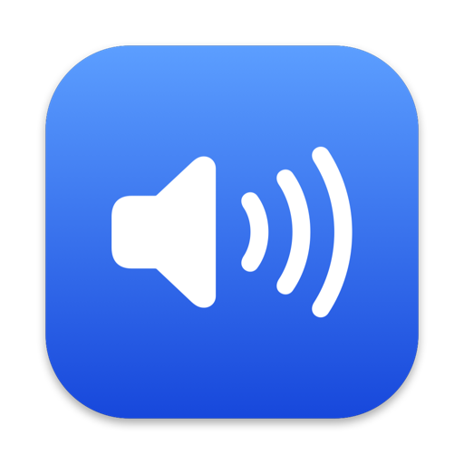
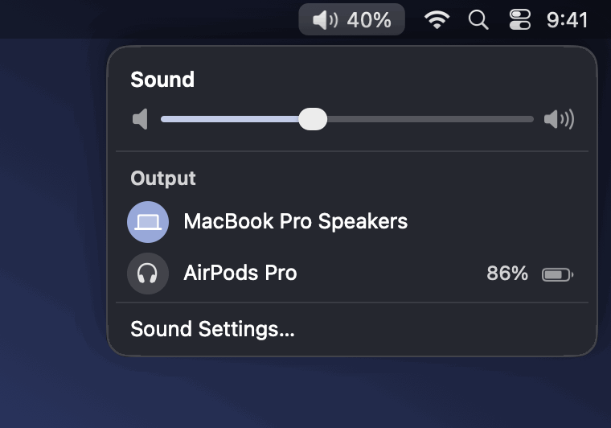

<p align="center">
  
</p>

<h1 align="center">VolumeScroll</h1>

<p align="center">
  Change your Mac's volume by scrolling over the menu bar icon, the way it should have always worked.
</p>

<p align="center">
  <a href="#install"><b>Install</b></a> ·
  <a href="#usage"><b>Usage</b></a> ·
  <a href="#build-from-source"><b>Build from source</b></a> ·
  <a href="LICENSE"><b>MIT License</b></a>
</p>

<p align="center">
  
  
  
</p>

<br>

VolumeScroll is a small menu bar app for Mac. Scroll over its icon, or over its open menu, to turn the volume up
and down. Click the icon for a Sound menu that looks like the one built into macOS: a slider and your output devices.

- **Scroll** over the icon or the open menu to adjust the volume. A mouse wheel changes it 2% per notch and speeds up when you spin it fast, and a
  trackpad scrolls smoothly. Up is always louder, whichever way natural scrolling is set. **Works great with an external mouse.**
- **Click** the icon for the Sound menu: a volume slider, your output devices (click one to switch, with the battery level for Bluetooth ones) and a
  link to Sound Settings. It is a real macOS menu, so it takes on the system look, including the glass on macOS 26.
- The icon shows the current volume as a percentage. **Right-click** it to mute or unmute, open at login, or quit.
- Minimal. No Dock icon, no account, no network access, and nothing running beyond what it needs.
- Free and open source, with no subscriptions and no App Store.

<p align="center">
  
</p>

<p align="center">
  <sub><b>Scroll</b> over the icon or the menu to change the volume. &nbsp;·&nbsp; <b>Click</b> the icon for the Sound menu.</sub>
</p>

## Install

### One-liner (recommended)

Open Terminal (press **⌘ Space**, type `Terminal`, press Return), paste this and press Return:

```bash
curl -fsSL https://raw.githubusercontent.com/hafizuddin-a/VolumeScroll/main/install.sh | bash
```

This downloads the source, builds it on your Mac and puts `VolumeScroll.app` in your Applications folder. You can ignore
Xcode-related warnings unless the script stops with an error. When it finishes, the icon appears in your menu bar. The
script is [`install.sh`](install.sh) if you would like to read it first.

### Manual

1. Clone or download this repo.
2. Run:

```bash
chmod +x install.sh && ./install.sh
```

That's it. The script builds from source and installs to `/Applications`.

## First launch

macOS will ask for **Accessibility permission**. It is needed to detect scroll events over the menu bar.

Go to **System Settings → Privacy & Security → Accessibility** and enable VolumeScroll.

If the icon doesn't show up on macOS 26, open **System Settings → Menu Bar** and make sure VolumeScroll is allowed
under **Allow in the Menu Bar**.

## Requirements

- macOS 13 (Ventura) or later, built to look its best on macOS 26
- Apple Silicon Mac (M1 and above)
- Xcode Command Line Tools (`xcode-select --install`)

## Usage

| Action | Result |
|---|---|
| Scroll up over the icon or the open menu | Volume up |
| Scroll down over the icon or the open menu | Volume down |
| Left click the icon | Open the Sound menu |
| Click a device in the menu | Switch the output device |
| Click the speaker icon at the left or right of the slider | Mute, or jump to maximum volume |
| Right click the icon | Menu (mute, open at login, quit) |

## Build from source

```bash
git clone https://github.com/hafizuddin-a/VolumeScroll
cd VolumeScroll
./build.sh
open VolumeScroll.app
```

The app is a few small Swift files: [AppDelegate.swift](AppDelegate.swift) (menu bar item, menu and scrolling),
[AudioController.swift](AudioController.swift) (volume and devices through CoreAudio) and
[SoundPanel.swift](SoundPanel.swift) (the menu contents). `build.sh` also draws the app icon with
[make_icon.swift](make_icon.swift), so there are no image assets to maintain.

## License

MIT. Based on [sujoff/VolumeScroll](https://github.com/sujoff/VolumeScroll).
